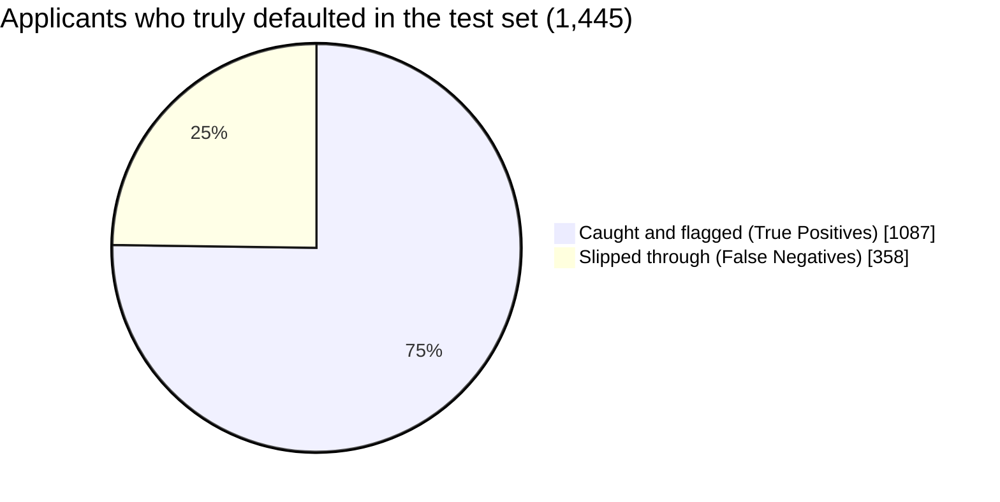

<p align="center">
  
</p>

<p align="center">
  
</p>

<p align="center">
  
  
  
</p>

<p align="center">
  
  
  
  
  
</p>

<p align="center">
  <a href="#-the-loan-officers-dilemma">The Dilemma</a> •
  <a href="#-dataset">Dataset</a> •
  <a href="#-the-approval-pipeline">Pipeline</a> •
  <a href="#-why-an-rbf-kernel-svm">Why SVM</a> •
  <a href="#-results">Results</a> •
  <a href="#-what-this-means-for-the-bank">Business Impact</a> •
  <a href="#-installation">Install</a>
</p>

---

##  The Loan Officer's Dilemma

> [!NOTE]
> **In one sentence:** this project trains a Support Vector Machine to read a loan application and decide whether the applicant is **safe** or **likely to default**, and it correctly flags **75% of the people who would actually default** on data it has never seen.

**Explain it like I'm five:**
You work at a bank and a stranger asks to borrow money. If you say yes and they never pay it back, the bank loses that money for good. If you say no to someone who *would* have paid, you only lose a customer. Both mistakes hurt, but **the first one hurts far more**. This model learns from 32,581 past loans which applicants tend to repay and which don't, then helps you make that call.

```
 Loan application  ➜   Clean & prepare  ➜   Kernel SVM  ➜   Approve   or    Flag as high risk
```

### Two mistakes, two very different price tags

| | The mistake | What happens | Cost to the bank |
|:-:|---|---|---|
|  | **Approve someone who defaults** *(False Negative)* | The loan is never repaid | **Loses real money** (the principal) |
|  | **Flag someone who would have repaid** *(False Alarm)* | An underwriter takes a second look | A bit of review time |

That imbalance drives every decision in this project, including which metric gets the spotlight.

---

##  Dataset

**Source:** [Credit Risk Dataset on Kaggle](https://www.kaggle.com/datasets/laotse/credit-risk-dataset)

**Scale:** **32,581 loan records** across **12 features** describing the applicant and the loan.

| Category | What it covers |
|---|---|
|  **Applicant** | Age, Income, Employment Length, Home Ownership (`RENT`, `OWN`, `MORTGAGE`, `OTHER`) |
|  **Loan** | Loan Amount, Loan Intent (`EDUCATION`, `MEDICAL`, `VENTURE`, etc.), Interest Rate, Loan Grade, Percent of Income |
|  **Credit history** | Default History (`Y`/`N`), Credit History Length |

###  What we predict: `loan_status`

| Value | Meaning |
|:---:|---|
| `0` |  Approved / Non-Default |
| `1` |  Default / High Risk |

<details>
<summary><b> Key feature glossary (click to expand)</b></summary>

<br/>

| Feature | Description |
|---|---|
| `person_age` | Applicant age |
| `person_income` | Annual income |
| `loan_amnt` | Requested loan amount |
| `loan_int_rate` | Loan interest rate |
| `loan_percent_income` | Loan-to-income ratio |
| `cb_person_cred_hist_length` | Credit history length |

</details>

---

##  The Approval Pipeline


<details>
<summary><b> Step 1: Explore the data</b></summary>

<br/>

Checked the data distributions and found which columns had missing values, so the cleaning work could be planned.

</details>

<details>
<summary><b> Step 2: Split first, to keep the exam honest</b></summary>

<br/>

`train_test_split` (**80/20**, `random_state=42`) was applied **before** any imputing or encoding was fitted. If the transformers had seen the test data first, information would leak into training and the results would look better than they truly are on brand-new applicants. Think of it as keeping the exam questions in a locked drawer until the student finishes studying.

</details>

<details>
<summary><b> Step 3: Filling the blanks</b></summary>

<br/>

`SimpleImputer` (mean strategy) filled the missing values in `loan_int_rate` and `person_emp_length`, so those rows were kept instead of thrown away.

</details>

<details>
<summary><b> Step 4: Turning words into numbers</b></summary>

<br/>

A `ColumnTransformer` with `OneHotEncoder` converted these text columns into numeric ones, since models can't do math on words:

- `person_home_ownership`
- `loan_intent`
- `loan_grade`
- `cb_person_default_on_file`

</details>

<details>
<summary><b> Step 5: Putting every feature on the same scale</b></summary>

<br/>

`StandardScaler` was applied to all features. This is **not optional** for an SVM: it works by measuring distances, so a feature in the tens of thousands (`person_income`) would drown out a feature in the tens (`person_age`) if left unscaled.

</details>

<details>
<summary><b> Step 6: Training</b></summary>

<br/>

```python
SVC(kernel='rbf', class_weight='balanced')
```

`class_weight='balanced'` makes missing a defaulter count for more during training. That steers the model away from the useless shortcut of saying "non-default" for everyone.

</details>

---

##  Why an RBF Kernel SVM?

Think of drawing a line between **safe** borrowers and **risky** ones on a map of applicants.

| Approach | The tool | The catch |
|---|---|---|
|  **Linear model** | A straight ruler | Real risk isn't straight: income, loan size, interest rate and debt ratio *interact* with each other |
|  **RBF Kernel SVM** | A flexible rope | Bends around the data to follow curved, complex risk boundaries |

Add `class_weight='balanced'` and the rope gets pulled harder toward catching the rarer, costlier group: the defaulters.

---

##  Results

Measured on the held-out test set.

###  The Scoreboard

```
Overall Accuracy        ██████████████████░░  87.77%
Non-Default Precision   ███████████████████░  0.93
Non-Default Recall      ██████████████████░░  0.91
Default Recall          ███████████████░░░░░  0.75   ◄ the one that protects the bank
Default F1-Score        ███████████████░░░░░  0.73
```

| Metric | Performance | In plain words |
|---|---:|---|
| **Overall Accuracy** | **87.77%** | Right about 9 times out of 10 overall |
| **Non-Default (0) Precision / Recall** | **0.93 / 0.91** | Reliable at recognizing safe borrowers |
| **Default Risk (1) Recall** | **0.75** | Catches 3 out of every 4 real defaulters |
| **Default Risk (1) F1-Score** | **0.73** | Balanced score for the risky class |

> [!IMPORTANT]
> **Why Class 1 Recall is the star metric:** most applicants are non-defaulters, so a model that leaned toward "approve everyone" could post a high accuracy while quietly letting the riskiest borrowers through. That is the exact failure this project was built to avoid.

###  Where did the 1,445 real defaulters go?



###  Confusion Matrix

<p align="center">
  
</p>

---

##  What This Means for the Bank

<table>
  <tr>
    <td align="center" width="50%">🎯<br/><b>Catching Default Risks</b><br/><br/>With <code>class_weight='balanced'</code>, the model reaches <b>75% recall</b> on defaulters, correctly flagging <b>1,087 of 1,445</b> high-risk applicants in the test set.</td>
    <td align="center" width="50%">🛡️<br/><b>Risk Mitigation vs. False Alarms</b><br/><br/>A modest drop in overall accuracy buys a big cut in missed defaults, down to just <b>358 False Negatives</b>, protecting the bank's capital.</td>
  </tr>
</table>

> [!TIP]
> **It's a trade, not a flaw.** A missed default is a write-off. A false alarm is usually just an extra underwriting review. Giving up a little accuracy and precision for much higher default recall is a deliberate, rational business choice.

---

##  Technologies Used

| Category | Tools |
|---|---|
| Language | 🐍 Python |
| Data Handling | Pandas, NumPy |
| Machine Learning | Scikit-learn (Kernel SVM) |
| Visualization | Matplotlib, Seaborn |

---

##  Project Structure

```
Bank-Loan-Approval-Prediction/
│
├── images/
│   └── confusion_matrix(SVM).png
├── data/
│   └── credit_risk_dataset.csv
├── notebooks/
│   └── bank_loan_approval_prediction.ipynb
├── README.md
└── requirements.txt
```

---

##  Installation

```bash
# 1. Clone the repository
git clone https://github.com/khaled-amireh/Bank-Loan-Approval-Prediction.git
cd Bank-Loan-Approval-Prediction

# 2. Create and activate a virtual environment (recommended)
python -m venv venv
source venv/bin/activate      # On Windows: venv\Scripts\activate

# 3. Install dependencies
pip install -r requirements.txt

# 4. Launch the notebook
jupyter notebook notebooks/bank_loan_approval_prediction.ipynb
```

---

##  Limitations

<details>
<summary><b>Click to see what this model does not do (yet)</b></summary>

<br/>

- Evaluated on a single train/test split, not cross-validated, so metrics may shift a little on a different split.
- The decision threshold behind the headline Precision/Recall was not explicitly tuned. Further gains on default recall may be possible by adjusting it to a specific cost trade-off.
- Kernel SVMs scale less efficiently to very large datasets than tree-based ensembles, so training time would need re-checking at much larger volumes.

</details>

---

##  Future Improvements

- [ ] Tune the decision threshold against a real cost function (missed default vs. false alarm)
- [ ] Add cross-validation for more robust estimates
- [ ] Benchmark against Random Forest and XGBoost, common in credit risk
- [ ] Tune `C` and `gamma` with grid or random search
- [ ] Use SHAP to explain *why* each applicant was flagged

---

## 👤 Author

<p align="center">
  <b>Khaled Amireh</b><br/>
  <a href="https://github.com/khaled-amireh">🔗 GitHub</a>
</p>

<p align="center"><i>If this project helped you, drop a ⭐ on the repo.</i></p>

<p align="center">
  
</p>
