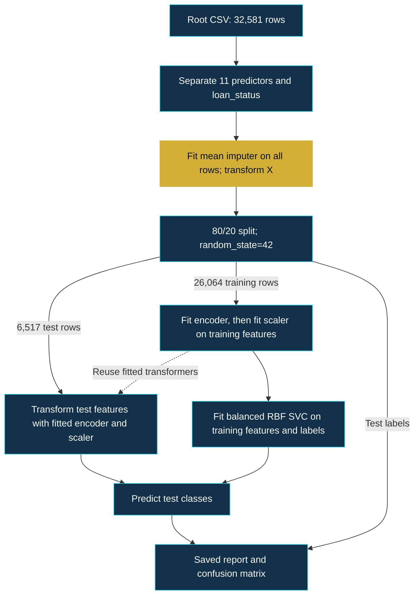

<p align="center">
  
</p>

# Credit Risk Intelligence

**Machine Learning for Loan Default Risk Assessment**

[](loan_prediction_model.py)
[](loan_prediction_model.py)
[](loan_prediction_model.ipynb)
[](LICENSE)

[Overview](#executive-overview) · [Dataset](#dataset-intelligence) · [Architecture](#machine-learning-architecture) · [Evaluation](#model-evaluation) · [Reproduce](#installation-and-reproduction)

## Executive overview

A focused machine learning case study of **binary loan-default classification** using an RBF Support Vector Machine. The repository preserves the original notebook, Python script, dataset, and confusion matrix so readers can inspect the implementation alongside its saved evaluation.

| Study at a glance | Verified scope |
|---|---|
| Data | 32,581 rows; 11 predictors and one binary target |
| Model | RBF SVM with balanced class weights |
| Evaluation | One 80/20 random split; 6,517 test rows |
| Artifacts | Notebook with saved outputs, matching core workflow in a script, original evaluation image |
| Status | Educational analysis; no deployed lending service or saved model artifact |

> [!IMPORTANT]
> The imputer learns column means from the full dataset **before** the split. Saved scores therefore have a known preprocessing-leakage limitation. The notebook and script also differ in their assignment of the imputer result. The [evidence audit](docs/implementation-evidence.md) identifies the exact locations; no corrected model was trained for this documentation update.

The engineering value of this study is its inspectable treatment of mixed feature types, class imbalance, feature scaling, and classification errors. The results describe this experiment and do not establish suitability for lending decisions.

## Business problem and target

Credit-risk analysis asks whether a loan is associated with default. This experiment learns `loan_status` from applicant, loan, and credit-history fields. The [publisher's data card](https://www.kaggle.com/laotse/credit-risk-dataset/metadata) defines the labels as follows:

| Label | Meaning | Role in evaluation |
|---|---|---|
| `0` | Non-default | Negative class |
| `1` | Default | Positive class; used for default recall |

A missed default and a false default flag have different business implications, so class-specific errors matter alongside accuracy. Their financial costs are not measured here; no loss amount, recovery rate, or lending policy is modeled.

The original plot calls class 0 “Approved,” and the sample prints “Approved” or “Default Risk / Rejected.” Those are presentation labels in the preserved implementation. The supervised target records default status, so a class-0 prediction does not establish approval eligibility or borrower safety. The sample also reuses `X_test[0]`; it is a demonstration on an existing test row.

## Dataset intelligence

The checked-in [CSV](credit_risk_dataset.csv) contains **32,581 rows and 12 columns: 11 predictors plus `loan_status`**. The attributed [Kaggle source](https://www.kaggle.com/laotse/credit-risk-dataset/metadata) describes simulated credit-bureau fields.

| Target | Records | Share |
|---|---:|---:|
| Non-default (`0`) | 25,473 | 78.18% |
| Default (`1`) | 7,108 | 21.82% |

The saved EDA consists of schema, descriptive statistics, and missing-value inspection. A read-only CSV audit also found 165 repeated full rows, maximum age 144, and maximum employment length 123 years. The original workflow retains them. These findings merit investigation before further modeling; they are not silently cleaned here.

| Feature group | Original predictors |
|---|---|
| Applicant | `person_age`, `person_income`, `person_home_ownership`, `person_emp_length` |
| Loan | `loan_intent`, `loan_grade`, `loan_amnt`, `loan_int_rate`, `loan_percent_income` |
| Credit history | `cb_person_default_on_file`, `cb_person_cred_hist_length` |

See [dataset provenance and inspection](docs/dataset.md) for source attribution and counting methods, and the [complete feature glossary](docs/feature-glossary.md) for all 12 columns, category counts, ranges, and unit caveats.

## Machine learning architecture

This diagram follows the **current code order**. The gold node marks the full-dataset imputation fit; it is a known evaluation limitation.



`train_test_split` uses `test_size=0.2` and `random_state=42`, without an explicit `stratify` argument or a temporal/group split. Encoding and scaling are separate fitted objects, not a single `Pipeline`. The [implementation evidence](docs/implementation-evidence.md) also records the notebook's differing assignment to `df` during imputation.

## Preprocessing

### Missing-value handling

| Field | Missing | Share | Implemented strategy |
|---|---:|---:|---|
| `loan_int_rate` | 3,116 | 9.56% | Mean imputation |
| `person_emp_length` | 895 | 2.75% | Mean imputation |

All other columns have no empty cells. The mean imputer is fitted on **all rows before splitting**, a confirmed source of test-feature leakage. The notebook assigns the estimator returned by `fit()` to `df`; the script assigns numeric output from `fit_transform()`. Both separately transform `X`. See the [preprocessing audit](docs/preprocessing.md) for the exact snippets and why the saved zero-missing display does not resolve that discrepancy.

### Encoding and scaling

`ColumnTransformer` applies `OneHotEncoder()` to home ownership, loan intent, loan grade, and historical-default status, passing through the seven numeric predictors. `StandardScaler()` then scales the **entire encoded feature matrix**, including one-hot indicators.

Both encoder and scaler fit on `X_train` and only transform `X_test`. These training-only fits are confirmed safeguards; they do not remove the earlier imputation leak. No explicit unknown-category handling or persisted preprocessing pipeline is provided. [Encoding and scaling details](docs/preprocessing.md#categorical-encoding) explain the actual order and what is left to library defaults.

## Support Vector Machine

Both implementations use the same explicit constructor:

```python
SVC(kernel='rbf', class_weight='balanced', random_state=42)
```

The RBF kernel supports nonlinear decision boundaries. Balanced weights adjust class penalties using training-label frequencies; they do not encode monetary costs. `C` and `gamma` are left to library defaults, and dependency versions are not pinned.

**No linear-versus-RBF comparison, class-weight ablation, hyperparameter search, or cross-validation is saved.** The [model reference](docs/model.md) distinguishes explicit settings from assumptions and explains why this experiment cannot establish the superiority of the chosen configuration.

## Model evaluation

**Saved accuracy: 87.77% · Default recall from saved counts: 75.22% · Test rows: 6,517**

The notebook prints accuracy `0.8777044652447445`. Its saved classification report rounds the class scores to two decimals:

| Class | Precision | Recall | F1 | Support |
|---|---:|---:|---:|---:|
| Non-default (`0`) | 0.93 | 0.91 | 0.92 | 5,072 |
| Default (`1`) | 0.71 | 0.75 | 0.73 | 1,445 |

Default precision measures how often a default flag is correct; default recall measures how many actual defaults are detected. F1 balances those two rates. An always-non-default rule would achieve 77.83% accuracy on these test labels but detect no defaults; that is an arithmetic reference, not a trained comparison.

These are **historical saved outputs**, checked against the original images and report. Training was not rerun. The full-data imputation leak and single-split design limit their interpretation. See [evaluation arithmetic and definitions](docs/evaluation.md) for exact fractions, averages, and the distinction between report rounding and recomputed rates.

### Confusion matrix and error analysis

<p align="center">
  
</p>

*Original saved image, unchanged. Rows are true labels and columns are predictions. Its “Approved (0)” label refers to the non-default class, not a verified approval decision.*

| Actual / predicted | Non-default (`0`) | Default (`1`) |
|---|---:|---:|
| Non-default (`0`) | 4,633 true negatives | 439 false positives |
| Default (`1`) | 358 false negatives | 1,087 true positives |

The model flags **1,087 of 1,445 default rows** and misses **358**. Among **1,526 default flags**, **439** are false positives. A flag could inform further investigation in a hypothetical workflow, but no review process, approval action, or financial benefit is evaluated here. [Error interpretation](docs/evaluation.md#confusion-matrix-and-error-interpretation) explains the denominators and limits.

## Reliability and limitations

| Confirmed safeguards | Confirmed limitations |
|---|---|
| Target excluded from predictors | Mean imputation fitted on full data before splitting |
| Classifier fitted on training rows | Notebook/script imputation assignment differs |
| Encoder and scaler fitted on training rows | One random split; no stratification or cross-validation |
| Split seed explicitly set to 42 | Extreme values and repeated rows retained; environment unpinned |

No visible model-selection loop reuses the test set, but earlier manual test reuse is **unknown**. Prediction-time availability of grade/rate/history fields, duplicate overlap between partitions, subgroup performance, and transfer to other populations are also unverified. The saved scores establish no measured savings, deployment readiness, fairness, or regulatory compliance.

The [reliability assessment](docs/reliability.md) separates confirmed findings from unanswered questions and explains why no corrected performance estimate can be inferred from the saved results.

## Future roadmap

- [ ] Fit imputation inside training folds and resolve notebook/script consistency in a separate implementation change.
- [ ] Pin an environment, verify clean-kernel execution, and capture reproducible evaluation artifacts.
- [ ] Investigate extreme values and repeated rows; design validation around available grouping or time metadata.
- [ ] Compare baselines and kernels, tune on training/validation data, and reserve an independent final test set.
- [ ] Study precision–recall tradeoffs, calibration, feature timing, and external/subgroup performance before any operational use.

These items are proposed work. No training, preprocessing, parameter, or output changes were made in this documentation sprint.

## Repository structure

```text
Bank-Loan-Prediction/
├── loan_prediction_model.ipynb       # Original notebook with saved outputs
├── loan_prediction_model.py          # Original script
├── credit_risk_dataset.csv           # Original local dataset
├── images/
│   ├── confusion_matrix(SVM).png     # Original evaluation plot
│   └── credit-risk-intelligence-banner.svg
├── docs/                            # Evidence and technical references
├── README.md
└── LICENSE                          # Original MIT license
```

## Installation and reproduction

For a dependency-free review, open the [saved notebook](loan_prediction_model.ipynb) on GitHub. For local inspection, the PowerShell example below uses an environment outside the checkout:

```powershell
git clone https://github.com/khaled-amireh/Bank-Loan-Prediction.git
cd Bank-Loan-Prediction
python -m venv "$env:TEMP\credit-risk-intelligence-venv"
& "$env:TEMP\credit-risk-intelligence-venv\Scripts\python.exe" -m pip install numpy pandas matplotlib seaborn scikit-learn notebook ipykernel
& "$env:TEMP\credit-risk-intelligence-venv\Scripts\python.exe" -m notebook loan_prediction_model.ipynb
```

The notebook metadata records **Python 3.11.9**. Exact dependency versions are **not pinned**, and no `requirements.txt` exists. This is an unpinned setup example; a fresh training run was not performed or verified during the documentation sprint. Run from the repository root so the relative CSV path resolves.

The [reproduction guide](docs/reproduction.md) provides macOS/Linux commands, an import-to-package map, intentional script-execution instructions for a separate experimental checkout, and troubleshooting. Review the known preprocessing discrepancy before rerunning or saving the original notebook.

## Author and license

**Khaled Amireh** · [GitHub](https://github.com/khaled-amireh) · [Portfolio](https://portfolio-1kpn.onrender.com)

Repository code is provided under the [MIT License](LICENSE). Dataset provenance and its publisher's terms should be considered separately from the repository license.

The original ML artifacts are preserved byte for byte; see the [SHA-256 baseline](docs/protection-baseline.md).
