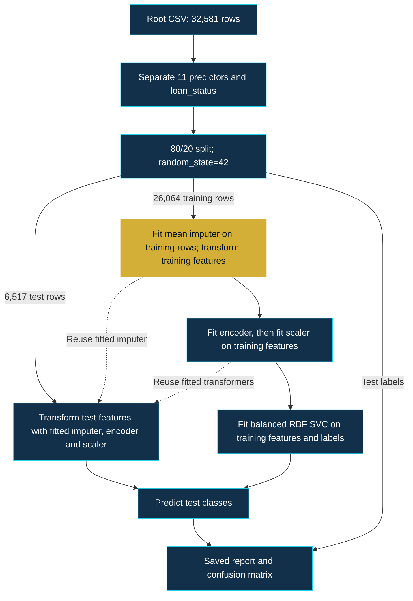

<p align="center">
  
</p>

# Credit Risk Intelligence

**Machine Learning for Loan Default Risk Assessment**

[](loan_prediction_model.py)
[](loan_prediction_model.py)
[](loan_prediction_model.ipynb)
[](LICENSE)

[Overview](#executive-overview) · [Dataset](#dataset-intelligence) · [Architecture](#machine-learning-architecture) · [Evaluation](#model-evaluation) · [Reliability](#reliability-and-limitations) · [Reproduce](#installation-and-reproduction)

## Executive overview

A focused machine learning case study of **binary loan-default classification** using an RBF Support Vector Machine. The notebook and Python script use equivalent training-only preprocessing; the dataset and original confusion-matrix image remain unchanged.

| Study at a glance | Verified scope |
|---|---|
| Data | 32,581 rows; 11 predictors and one binary target |
| Model | RBF SVM with balanced class weights |
| Evaluation | One 80/20 random split; 6,517 test rows |
| Artifacts | Notebook with saved outputs, matching core workflow in a script, original evaluation image |
| Status | Educational analysis; no deployed lending service or saved model artifact |

> [!IMPORTANT]
> Mean imputation now fits on training rows only, followed by test-only transformation. A fresh-kernel evaluation reproduced the historical accuracy and confusion matrix, with no changed predictions versus a pre-fix replay. The [evaluation record](docs/evaluation.md#corrected-workflow-verification) distinguishes this corrected run from the historical baseline; the remaining single-split limitations still apply.

The engineering value of this study is its inspectable treatment of mixed feature types, class imbalance, feature scaling, and classification errors. The results describe this experiment and do not establish suitability for lending decisions.

## Business problem and target

Credit-risk analysis asks whether a loan is associated with default. This experiment learns `loan_status` from applicant, loan, and credit-history fields. The [publisher's data card](https://www.kaggle.com/laotse/credit-risk-dataset/metadata) defines the labels as follows:

| Label | Meaning | Role in evaluation |
|---|---|---|
| `0` | Non-default | Negative class |
| `1` | Default | Positive class; used for default recall |

A missed default and a false default flag have different business implications, so class-specific errors matter alongside accuracy. Their financial costs are not measured here; no loss amount, recovery rate, or lending policy is modeled.

The original plot calls class 0 “Approved,” and the sample prints “Approved” or “Default Risk / Rejected.” Those are presentation labels in the preserved implementation. The supervised target records default status, so a class-0 prediction does not establish approval eligibility or borrower safety. The sample also reuses `X_test[0]`; it is a demonstration on an existing test row.

## Dataset intelligence

The checked-in [CSV](credit_risk_dataset.csv) contains **32,581 rows and 12 columns: 11 predictors plus `loan_status`**. The attributed [Kaggle source](https://www.kaggle.com/laotse/credit-risk-dataset/metadata) describes simulated credit-bureau fields.

| Target | Records | Share |
|---|---:|---:|
| Non-default (`0`) | 25,473 | 78.18% |
| Default (`1`) | 7,108 | 21.82% |

The saved EDA consists of schema, descriptive statistics, and missing-value inspection. A read-only CSV audit also found 165 repeated full rows, maximum age 144, and maximum employment length 123 years. The original workflow retains them. These findings merit investigation before further modeling; they are not silently cleaned here.

| Feature group | Original predictors |
|---|---|
| Applicant | `person_age`, `person_income`, `person_home_ownership`, `person_emp_length` |
| Loan | `loan_intent`, `loan_grade`, `loan_amnt`, `loan_int_rate`, `loan_percent_income` |
| Credit history | `cb_person_default_on_file`, `cb_person_cred_hist_length` |

See [dataset provenance and inspection](docs/dataset.md) for source attribution and counting methods, and the [complete feature glossary](docs/feature-glossary.md) for all 12 columns, category counts, ranges, and unit caveats.

## Machine learning architecture

This diagram follows the **current code order**. The gold node marks mean imputation fitted exclusively on training rows.



`train_test_split` uses `test_size=0.2` and `random_state=42`, without an explicit `stratify` argument or a temporal/group split. Imputation, encoding, and scaling are separate fitted objects, not a single `Pipeline`. The [historical audit](docs/implementation-evidence.md) records the pre-fix implementation.

## Preprocessing

### Missing-value handling

| Field | Missing | Share | Implemented strategy |
|---|---:|---:|---|
| `loan_int_rate` | 3,116 | 9.56% | Mean imputation |
| `person_emp_length` | 895 | 2.75% | Mean imputation |

All other columns have no empty cells. Both implementations split raw `X` and `y` first, then use `imputer.fit_transform(X_train[missing_cols])` and `imputer.transform(X_test[missing_cols])`. The raw `df` remains available for EDA; missingness verification checks both prepared partitions. This also removes the notebook's former assignment of an estimator to `df`. See the [preprocessing details](docs/preprocessing.md).

### Encoding and scaling

`ColumnTransformer` applies `OneHotEncoder()` to home ownership, loan intent, loan grade, and historical-default status, passing through the seven numeric predictors. `StandardScaler()` then scales the **entire encoded feature matrix**, including one-hot indicators.

Both encoder and scaler fit on `X_train` and only transform `X_test`; their code is unchanged. Together with training-only imputation, all learned preprocessing now follows this fit boundary. No explicit unknown-category handling or persisted preprocessing pipeline is provided. [Encoding and scaling details](docs/preprocessing.md#categorical-encoding) explain the actual order and what is left to library defaults.

## Support Vector Machine

Both implementations use the same explicit constructor:

```python
SVC(kernel='rbf', class_weight='balanced', random_state=42)
```

The RBF kernel supports nonlinear decision boundaries. Balanced weights adjust class penalties using training-label frequencies; they do not encode monetary costs. `C` and `gamma` are left to library defaults, and dependency versions are not pinned.

**No linear-versus-RBF comparison, class-weight ablation, hyperparameter search, or cross-validation is saved.** The [model reference](docs/model.md) distinguishes explicit settings from assumptions and explains why this experiment cannot establish the superiority of the chosen configuration.

## Model evaluation

**Corrected-run accuracy: 87.77% · Default recall: 75.22% · Test rows: 6,517**

The corrected notebook run prints accuracy `0.8777044652447445`. Its regenerated classification report rounds the class scores to two decimals:

| Class | Precision | Recall | F1 | Support |
|---|---:|---:|---:|---:|
| Non-default (`0`) | 0.93 | 0.91 | 0.92 | 5,072 |
| Default (`1`) | 0.71 | 0.75 | 0.73 | 1,445 |

Default precision measures how often a default flag is correct; default recall measures how many actual defaults are detected. F1 balances those two rates. An always-non-default rule would achieve 77.83% accuracy on these test labels but detect no defaults; that is an arithmetic reference, not a trained comparison.

The corrected workflow was evaluated once in a fresh kernel. A pre-fix replay in the same installed environment matched the historical baseline, and **0 of 6,517 predictions changed** after the fix; train/test row indices and feature order were identical. Accuracy and default precision/recall/F1 each changed by **0.00 percentage points**. See [the evaluation comparison and environment](docs/evaluation.md#corrected-workflow-verification). Identical scores do not remove the remaining single-split limitations.

### Confusion matrix and error analysis

<p align="center">
  
</p>

*Historical image, unchanged; its counts also match the corrected run. The notebook's inline plot was regenerated. Rows are true labels and columns are predictions. “Approved (0)” refers to non-default, not a verified approval decision.*

| Actual / predicted | Non-default (`0`) | Default (`1`) |
|---|---:|---:|
| Non-default (`0`) | 4,633 true negatives | 439 false positives |
| Default (`1`) | 358 false negatives | 1,087 true positives |

The model flags **1,087 of 1,445 default rows** and misses **358**. Among **1,526 default flags**, **439** are false positives. A flag could inform further investigation in a hypothetical workflow, but no review process, approval action, or financial benefit is evaluated here. [Error interpretation](docs/evaluation.md#confusion-matrix-and-error-interpretation) explains the denominators and limits.

## Reliability and limitations

| Confirmed safeguards | Confirmed limitations |
|---|---|
| Target excluded from predictors | No independent external validation |
| Imputer fitted on training rows; script/notebook preprocessing aligned | No persisted fitted model or transformers |
| Encoder and scaler fitted on training rows | One random split; no stratification or cross-validation |
| Split seed explicitly set to 42 | Extreme values and repeated rows retained; environment unpinned |

No visible model-selection loop reuses the test set, but earlier manual test reuse is **unknown**. Prediction-time availability of grade/rate/history fields, duplicate overlap between partitions, subgroup performance, and transfer to other populations are also unverified. The saved scores establish no measured savings, deployment readiness, fairness, or regulatory compliance.

The [reliability assessment](docs/reliability.md) separates confirmed findings from unanswered questions and explains why no corrected performance estimate can be inferred from the saved results.

## Future roadmap

- [x] Fit mean imputation on training rows and align script/notebook preprocessing.
- [ ] Pin dependency versions and capture a reusable evaluation environment.
- [ ] Investigate extreme values and repeated rows; design validation around available grouping or time metadata.
- [ ] Compare baselines and kernels, tune on training/validation data, and reserve an independent final test set.
- [ ] Study precision–recall tradeoffs, calibration, feature timing, and external/subgroup performance before any operational use.

The imputation fix and a fresh-kernel evaluation are complete; the remaining items are proposed work. The original SVM configuration, features, split ratio, and seeds are unchanged.

## Repository structure

```text
Bank-Loan-Prediction/
├── loan_prediction_model.ipynb       # Notebook with corrected preprocessing and relevant outputs
├── loan_prediction_model.py          # Script with the same minimal fix
├── credit_risk_dataset.csv           # Original local dataset
├── images/
│   ├── confusion_matrix(SVM).png     # Original evaluation plot
│   └── credit-risk-intelligence-banner.svg
├── docs/                            # Evidence and technical references
├── CONTRIBUTING.md                  # Documentation and experiment review guidance
├── README.md
└── LICENSE                          # Original MIT license
```

## Installation and reproduction

For a dependency-free review, open the [saved notebook](loan_prediction_model.ipynb) on GitHub. For local inspection, the PowerShell example below uses an environment outside the checkout:

```powershell
git clone https://github.com/khaled-amireh/Bank-Loan-Prediction.git
cd Bank-Loan-Prediction
python -m venv "$env:TEMP\credit-risk-intelligence-venv"
& "$env:TEMP\credit-risk-intelligence-venv\Scripts\python.exe" -m pip install numpy pandas matplotlib seaborn scikit-learn notebook ipykernel
& "$env:TEMP\credit-risk-intelligence-venv\Scripts\python.exe" -m notebook loan_prediction_model.ipynb
```

The notebook metadata and verified corrected run use **Python 3.11.9**. Dependency versions are **not pinned**, and no `requirements.txt` exists; the [evaluation record](docs/evaluation.md#corrected-workflow-verification) records the installed versions used for this run. The setup example remains unpinned. Run from the repository root so the relative CSV path resolves.

The [reproduction guide](docs/reproduction.md) provides macOS/Linux commands, an import-to-package map, intentional script-execution instructions for a separate experimental checkout, and troubleshooting. The former imputation discrepancy is resolved in both implementations.

## Documentation and contributions

Use the [implementation evidence](docs/implementation-evidence.md) to trace claims to original source locations, the [reproduction guide](docs/reproduction.md) to inspect or investigate the study locally, and the [contribution guide](CONTRIBUTING.md) to propose focused changes. The [verification record](docs/verification.md) documents the scope and checks of this documentation sprint.

## Author and license

**Khaled Amireh** · [GitHub](https://github.com/khaled-amireh) · [Portfolio](https://portfolio-1kpn.onrender.com)

Repository code is provided under the [MIT License](LICENSE). Dataset provenance and its publisher's terms should be considered separately from the repository license.

The dataset, existing image assets, and license remain byte for byte unchanged. The [SHA-256 baseline](docs/protection-baseline.md) records the historical artifacts before this separately scoped code fix.
